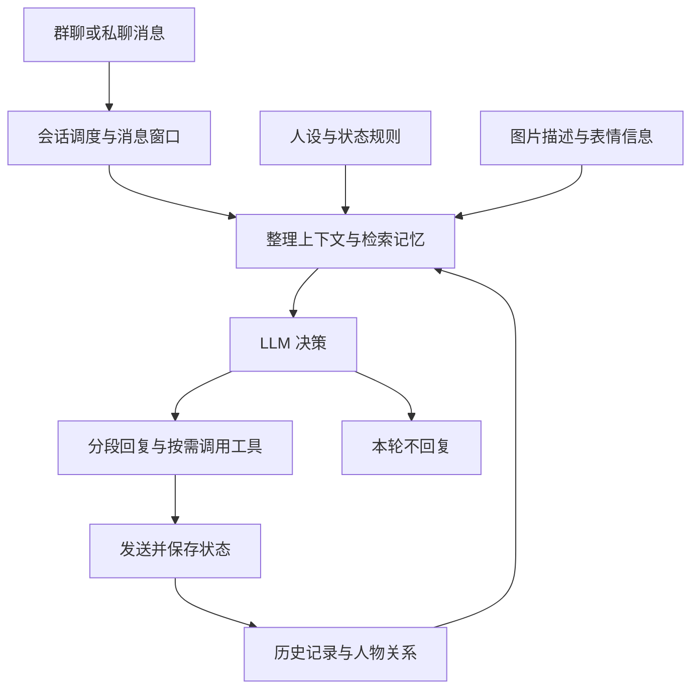

# mem_chat

面向角色扮演与持续社交对话的 AstrBot 插件，仓库内附默认角色「爱丽丝」的人设与状态规则。

mem_chat 把群聊消息按周期整理成对话窗口，结合角色设定、历史记忆、人物关系和图片信息，由 LLM 判断是否参与、回应哪些人，以及如何分段回复。框架负责调度、调用工具、发送消息和保存状态。

## 目录

- [核心功能](#核心功能)
- [默认角色：爱丽丝](#默认角色爱丽丝)
- [架构与回复流程](#架构与回复流程)
- [快速开始](#快速开始)
- [文档与开发](#文档与开发)
- [许可证](#许可证)

## 核心功能

| 能力 | 作用 |
| --- | --- |
| 群聊参与 | 支持被 @、引用与戳一戳触发；通过专注模式（Focus）跟进对话，通过读空气（Read Air）判断是否主动接话。按消息窗口处理，可分段回应多人。 |
| 私聊与持续互动 | 支持白名单私聊；在用户明确要求持续推进或跟进时，由持续场景引擎按节奏唤醒模型，结合当前状态继续互动。 |
| 长期记忆 | 保存并检索事件、知识和历史信息，为当前对话补充相关记忆。语义检索需要配置 embedding 模型。 |
| 人物印象与关系 | 记录昵称、偏好、互动边界与关系变化，让回复结合熟悉程度和已有印象。 |
| 图片与表情包 | 结合图片描述与图中文字理解消息，记录重复图片的熟悉度和称呼；支持保存、检索表情包及发送前看图核对。 |
| 工具扩展 | 可接入搜索、网页读取、Codex 等工具。需要启用工具调用，并分别准备对应服务、插件或本地 CLI。 |

是否回复、说什么、用什么语气和表情，主要交给 LLM 判断。模型可以选择 `no_reply`；调度周期表示一次判断机会，并不保证每次都发消息。

## 默认角色：爱丽丝

在默认角色设定中，爱丽丝本人存在于基沃托斯，这边的聊天是通过 LLM 建立的跨世界投影与连接。这个设定作为角色身份的基础，与日常对话、记忆和关系状态共同影响表达。

日常语气以善意、友好、认真为底色，带一些游戏式表达；会根据熟悉程度、对方的行为和当前心情调整反应。爱丽丝自称「爱丽丝」；凯伊只在明确切换时使用独立的口吻与自称。

完整设定已经包含在仓库中：

- [核心人设](personas/personas.txt)：身份、世界观、表达习惯与互动风格。
- [状态规则](personas/state_rules.txt)：读空气、被点名、私聊等状态下的行为要求。

可以修改这些文件来调整角色；修改后重新加载插件。最终回复还受当前上下文、记忆、关系和所用模型影响。

## 架构与回复流程

1. **收到消息**：识别会话、发言人、引用与图片，记录待处理内容。
2. **安排处理**：群聊的 @ 消息短暂合并成窗口；Focus 与 Read Air 按各自周期触发，私聊持续场景按场景状态唤醒。
3. **准备上下文**：组合本轮消息、人设、状态规则、相关记忆、人物印象与图片描述。
4. **交给模型**：判断是否回复、回应哪些内容，以及回复分段、表情或工具动作。
5. **执行与记录**：处理结构化输出、调用获准工具、发送消息，并保存历史与状态变化。

代码入口：[消息接入](main.py)、[调度器](src/core/scheduler.py)、[会话状态](src/core/state.py)、[LLM 与回复处理](src/llm_client.py)、[持续场景](src/scene/engine.py)、[数据库](src/db/database.py)。

## 快速开始

需要已有可运行的 AstrBot、已连接的聊天平台适配器，以及可用的对话模型接口。QQ 场景需要先接通相应适配器（例如 NapCat / OneBot）。

1. 将本仓库放入 AstrBot 的 `data/plugins/astrbot_plugin_mem_chat/` 目录。
2. 在 AstrBot WebUI 中打开本插件的配置，填写模型接口与允许参与的会话。
3. 按需配置 embedding、图片识别和工具服务，然后重新加载插件；首次加载会初始化数据库。
4. 在允许的群中 @ 机器人，或从已配置的私聊账号发消息，确认基础对话可用。

先关注以下配置即可，完整字段和说明见 [_conf_schema.json](_conf_schema.json)：

| 配置 | 用途 |
| --- | --- |
| `custom_llm_base_url` / `custom_llm_api_key` | 自定义对话模型接口地址与密钥。 |
| `custom_llm_model` / `llm_model` | 模型名称；`llm_model` 默认继承 `custom_llm_model`。 |
| `custom_llm_format` / `llm_format` | 与接口匹配的请求格式。 |
| `group_whitelist` | 允许参与的群；留空时不过滤群。 |
| `private_chat_uids` | 允许私聊的账号；留空时关闭私聊。 |
| `read_air_enable` | 是否启用读空气，自主判断是否参与群聊。 |
| `embedding_openai_*` | 语义记忆和表情检索所需的 embedding 接口。 |
| `meme_vision` | 独立识图接口、模型与显式备用站点配置。 |
| `enable_llm_tools` | 是否启用 LLM 工具调用，默认关闭。 |
| `scene_engine_enabled` | 是否启用用户明确要求的私聊持续互动。 |

图片处理可以接入 `vision_media` 插件；本插件的 `meme_vision` 用于图片补充描述、存表情识别和发送前选图。启用发送前核对时，需要对应模型支持图片输入；候选不贴切或核对失败时可以不发表情。

Codex 桥接还需要本机安装并配置可用的 Codex CLI，设置 `codex_enabled`、工作目录和调用权限等参数。其他工具也有各自依赖，启用总开关后仍需完成对应配置。

管理命令入口为 `/mem_chat`，记忆管理可使用 `/mc_add`、`/mc_list`。指令前缀由 AstrBot 设置决定；若使用 `#`，请相应改为 `#mem_chat` 等，详见 [指令前缀说明](DEVELOPMENT.md)。

## 文档与开发

- [更新记录](CHANGELOG.md)：从旧首页移出的各次修改说明。
- [旧版使用与技术参考](docs/LEGACY_REFERENCE.md)：保留旧参数、接口示例与技术说明，供追溯，部分内容可能已过时。
- [常驻协议与语义工具路由草案](docs/DESIGN_DRAFT.md)：方案讨论，包含尚未全部实现的设计。
- [记忆系统设计说明](DEVELOPMENT_MEMORY_SPEC.md)：记忆系统的设计目标与方案。
- [开发备注](DEVELOPMENT.md)：命令前缀等开发与使用约定。

## 许可证

代码采用 [GNU AGPL v3](LICENSE)。
