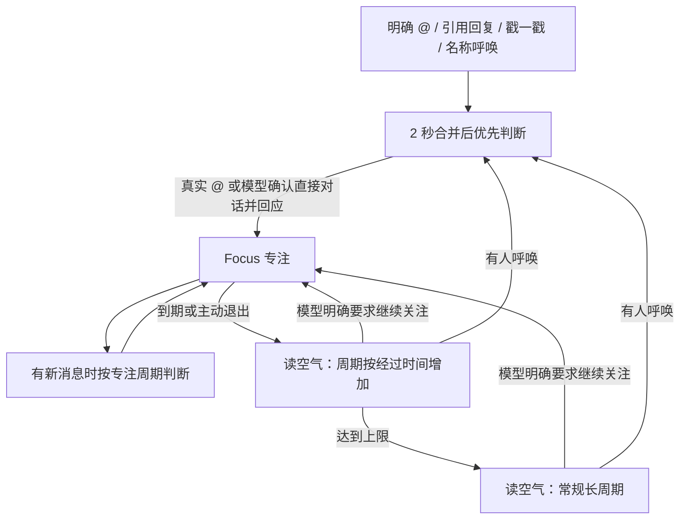

# 爱丽丝注意力与周期调度 Spec v2

状态：已实现（2026-11-04）。本文记录本次群聊注意力调度的行为约定；验证包括调度回归测试、完整回复队列测试及当前配置模型的独立协议检查。

## 1. 目标与范围

让爱丽丝能决定继续关注一段对话；专注结束后逐步降低关注频率；群友直接喊名字时能像 @ 一样及时进入判断。

回复意愿与关注时长分开：`no_reply` 表示这轮不发消息，不等于退出关注。模型可以保持沉默并延长 focus。周期只提供判断机会，不能强制回复。

v2 调整群聊调度、群聊提示协议、名称呼唤识别及相关测试。普通私聊的 3～5 秒合并和独立持续场景引擎保持现有行为；群聊的 focus 控制不会开启私聊连续发言。

## 2. 行为概览



Focus 与 Read Air 仍使用原有会话调度；“逐步降温”是 Read Air 的周期阶段，不新增一套并行回复器。每个会话只允许一个常规周期计时器和一个执行中的回复任务。

## 3. 模型主动控制 Focus

在现有 `control` 内增加可选 `focus`：

```json
{
  "control": {
    "decision": "no_reply",
    "focus": {
      "action": "extend",
      "seconds": 90,
      "reason": "对方说还有下一张图，先等他发完"
    }
  },
  "response": {}
}
```

| action | 含义 |
| --- | --- |
| `keep` 或缺省 | 保持当前计时；普通主动回复不会重开 focus 或重置降温。 |
| `extend` | 当前仍在 focus 时增加剩余时长；处于 Read Air 时重新进入 focus。 |
| `release` | 本轮处理结束后退出 focus，启动读空气逐步降温。 |

`seconds` 仅对 `extend` 有效，必须为有限正数；缺省 60 秒，单次最多 120 秒，剩余 focus 总时长最多 900 秒。非法字段忽略，其他有效回复照常处理。`reason` 为可选简短日志依据，不发给群友。

具体语义：

- 正在 focus 且剩 40 秒，输出 `extend +90`，结果为剩 130 秒，不会缩短成 90 秒。
- Read Air 中 `no_reply + extend 90`：保持沉默，进入约 90 秒 focus。
- `reply_only + release`：本轮正常回复，随后进入降温；显式 `release` 优先于自动进入 focus。
- LLM 不输出新字段时，沿用默认时长，不要求每轮填写。
- 普通主动回复保持当前降温；从 Read Air 显式 `extend` 时按请求时长进入 focus，不额外叠加默认 100 秒。
- 真正 @ 在消息到达时启动/保障默认 100 秒 focus；名称命中仅优先判断，不预先刷新关注。名称候选由模型输出 `control.addressed` 布尔值；确认为直接对话且实际回应后，才保障默认窗口。`no_reply` 不自动进入 focus，仍可显式 `extend` 等待后续。
- 延长关注不会增加好感、刷新实际发送时间或生成空回复。`no_reply` 的本轮消息正常标记已判断，等待的是未来新消息。
- 当本轮模型输出有效且该轮未被中断时应用控制；接口异常、协议解析失败、过期或已被更新呼唤取代的旧轮次不得写回关注状态。
- 执行中 focus 到期可先进入降温；模型稍后返回有效 `extend` 可重新进入 focus。结果应用时依据最新会话版本校验，避免旧轮次覆盖后来发生的新呼唤。

提供给模型的状态控制在一小段内：当前阶段、focus 剩余秒数、下次检查间隔、本轮呼唤来源。指导语建议：

> 有人在与你对话、还在补充或问题没有说完时，可以延长 focus。旁观时可以自然插一句；是否继续参与，看后续有没有人与你互动、自己是否还有值得说的话。普通主动插话不会重开 focus，也不会重置降温。不想接这轮可以 no_reply。

群聊没有新待处理消息时不额外调用 LLM 来决定是否续期；到期由框架完成。

## 4. Focus 内的周期

保留当前基准 30 秒、8～120 秒动态范围；大群乘现有 1.8 倍，即基准 54 秒、14.4～216 秒范围。呼唤可加快后续专注周期，普通实际发言后逐步放慢。

- 真正 @ 和名称呼唤均使用固定 2 秒合并截止，不受普通发送冷却延迟；在忙时排入下一批，不打断正在发送的群聊回复。
- Focus 普通周期仅处理新待处理窗口；模型允许 `no_reply`。不因定时器到点而强行发言。
- 普通发言只放慢周期，不自动无限续期；模型通过 `extend` 表达继续关注的意愿。
- 移除“读空气后大群 focus 只剩 45 秒”的单独限制；群大小主要作用于周期与参与判断。
- 每次新进入或显式延长 focus 后，剩余时长至少覆盖一次已计划的判断等待，再留 15 秒处理余量；向上补足并记录实际值，上限仍为 900 秒。这里保障的是一次判断机会，不保证消息发送或超长工具任务完成。
- 到期转换使用独立的状态截止时间，不等待一个更长的 focus 定时器醒来才发现过期。

## 5. Focus 结束后的线性降温

Focus 到期或模型 `release` 后，以单调时钟记录降温起点，等待间隔按实际经过时间线性增长。默认 300 秒内达到本群常规间隔；大群倍率影响间隔上限，不延长降温所需时间。

```text
progress = clamp(降温实际经过秒数 / read_air_transition_duration_sec, 0, 1)
start = min(本群常规间隔, read_air_transition_start_sec × 大群倍率)
wait = start + (本群常规间隔 - start) × progress
minimum_messages = 1 + floor((本群常规消息门槛 - 1) × progress)
```

以幻夜当前 3.2 倍率、15 条常规门槛为例：

| 从进入降温起经过 | 此时安排的新等待 | 最少未处理消息 |
| --- | --- | --- |
| 0 秒 | 64 秒 | 1 条 |
| 150 秒 | 512 秒 | 8 条 |
| 300 秒及以后 | 960 秒 | 15 条 |

这些是各时刻新安排的等待值，并非固定发言时间表；执行判断时仍需满足消息门槛、队列和模型意愿。已有计时器不会被普通消息不断推迟；真正呼唤仍立即进入快速通道。没有新消息不调用模型。

普通主动回复、第三人称名称提及、已在降温时重复 `release` 均不重置降温起点。真正进入 focus 后清除本轮降温；focus 再结束时才开启下一轮。模型可通过显式 `extend` 继续关注。接口失败保留现有有限重试，模型明确 `no_reply` 正常消费本轮消息。

门槛不足时保留有效消息，等待积累；达到常规间隔且没有待处理消息后停止空计时器。启动或重启时没有有效 focus 的会话直接采用常规长周期。

## 6. 有人叫爱丽丝：名称呼唤

增加 `attention_names`，建议默认 `["爱丽丝", "天童爱丽丝"]`。其他昵称如“爱宝”“Aris”由用户按需添加，不自动从普通群友昵称推断。

- 从本条消息由发送者直接输入的文字检测名称；图中文字、识图描述、引用原文、转发内容不会单独触发呼唤。
- “爱丽丝”“爱丽丝你看看”“这个怎么办，爱丽丝？”等名称命中作为呼唤候选进入与 @ 一样的快速通道，标记 `wake_reason=name_call`。
- 简单去除明确的非呼唤词条匹配，例如完整书名“爱丽丝梦游仙境”；不堆叠大量手写语义规则。其他含糊提及交给同一轮 LLM 判断。
- 提示中明确区分 `platform_at` 与 `name_call`：名称候选使用旁观状态提示，不预设已经被直接呼唤；在同一轮输出 `control.addressed`，不额外调用分类模型。
- “我刚才跟爱丽丝聊过”“有人画过爱丽丝吗”等第三人称提及可能误唤醒，但模型仍可 `no_reply`；v2 接受少量额外判断，避免另接一轮分类模型拖慢明确呼唤。
- 名称候选享有与 @ 相同的合并和优先级，但不在到达时刷新 focus；模型以 `control.addressed=true/false` 判断直接对话。第三人称提及即使选择插一句，也不自动进入 focus；无需额外输出 `release`。
- 同批里有真实 @ 时以真实 @ 为主，保持一次任务；无论触发方式如何，本轮仍整体阅读消息窗口，可用 segments 回应多人。

## 7. 同步处理现有时序问题

这些是新机制可靠运行的前提：

- **过期时间匹配实际等待**：普通消息的保留时长建议为 `max(180, 2 × 本群常规读空气间隔 + 60)` 秒，即普通群 660 秒、大群 1140 秒，从入队时间计算，不因每次跳过而无限续期。首次等待加一次未达门槛的积累仍有机会参与判断；有效检查截止若因排队超过保留时间，应记录超时原因。不能继续用 360 秒过期对待 540 秒大群等待。
- **区分过期与门槛不足**：门槛不足只跳过，不清空计数和有效消息；过期按消息逐条处理。计数从未处理窗口计算，已消费的 focus / @ 消息不再计入后续读空气。
- **保护定向消息**：真实 @ 与名称呼唤不被 50 条普通聊天缓存挤掉。普通背景仍有有界缓存；定向消息单独受队列时限和总量保护，达到上限时保留较新的定向请求并记录溢出。
- **单会话串行**：一个批次处理期间，新消息留在后续窗口；控制字段与消费操作只应用本轮快照，旧结果不能覆盖新状态。
- **明确任务超时**：队列与执行共享有限预算，耗尽时不能把“剩余 0 秒”解释为无限等待；失败保留消息的同时，必须安排一次有限的重试机会。
- **忙时保留待检查意图**：临时跳过的 Read Air 检查应在队列空闲后重排，避免只记住 Focus 的延后执行而丢掉读空气检查。

## 8. 配置与兼容

当前配置如下：

| 配置 | 建议默认值 | 含义 |
| --- | --- | --- |
| `attention_names` | `["爱丽丝", "天童爱丽丝"]` | 名称呼唤候选词。 |
| `read_air_transition_start_sec` | `20` | 退出 focus 后首轮读空气等待。 |
| `read_air_transition_duration_sec` | `300` | 经过多少实际秒数达到常规间隔与消息门槛。 |
| `read_air_transition_step_sec` | `20` | 已弃用的按轮次增量，保留旧配置兼容。 |

继续使用现有心跳上限、大群倍率、focus 基准与范围、单次续期上限和剩余时长上限。旧 `large_group_focus_duration_cap_sec=45` 不再限制新机制，配置说明标记弃用。

保持旧 JSON 输出兼容：没有 `control.focus` 时仍能正常回复。新周期逻辑及统计日志随版本一起启用；不修改人设、不清洗历史台词、不强制改变模型的回复意愿。

## 9. 验收场景

1. 普通群、大群退出 focus，初始等待分别为 20 / 36 秒；经过 150 秒分别为 160 / 288 秒，经过 300 秒封顶 300 / 540 秒，门槛同步增长。
2. Focus 剩 40 秒，模型 `extend 90` 后剩 130 秒；超过上限被裁剪；`release` 后开始降温。
3. `no_reply + extend` 不发消息、不更新发送时间或好感，但下一条新消息仍能在 focus 周期内被判断。
4. `reply_only + release` 本轮正常发言，随后进入降温；没有新字段时兼容旧模型输出。
5. “爱丽丝你看看这个”走 2 秒通道；多次呼唤不推迟第一条截止；含名字的图片或引用不触发名称呼唤。
6. 第三人称提及不刷新 focus 或降温；模型确认直接对话并回应后才有默认 focus。名称呼唤不自动收藏图片或执行他人的工具请求。
7. 大群不会再出现 focus 45 秒而首次跟进等待 54 秒的矛盾；900 秒上限内至少保障一次有效判断窗口。
8. 普通群 4 条消息未达到长周期门槛后仍保留，第 5 条在有效保留期内到达可以参与下一次判断；大群同理。
9. 大群等待 540 秒后，属于本轮的早期消息不会仅因正常等待而被判过期。
10. 处理过程中再收到呼唤，只处理各自批次；旧轮次续期/退出不能覆盖更新后的 focus。
11. 大量普通聊天不能挤掉尚未处理的 @ / 名称呼唤；空窗口不调用 LLM，达到冷态后没有无限空轮询。
12. 发送失败、超时、图片候选为空时不伪装实际发言；仍保留不回复和单独发表情的现有行为。
13. 普通主动发言不重开 focus；重复 `release` 不重置降温；同批真实 @ 不会被名字提及或普通尾消息覆盖。

建议日志包含：触发来源、原阶段与新阶段、focus 剩余时长、模型请求及裁剪后的续期、降温经过时间、下次截止时间、待处理/已消费/过期条数。以这些日志评估真实跟进延迟与发言率，而非只看配置值。


## 2026-11-05: Traffic-based observation and optional bubbles

Production enables `activity_scheduling_enabled`. Membership counts and the legacy per-group frequency multipliers no longer change timing or add participation warnings. Disabling the setting restores the previous policy.

- Track deduplicated human arrivals over two and ten minutes. Images/stickers count. Adjacent messages from the same sender within eight seconds share a traffic unit; all original messages remain in the reply batch. Assistant/plugin output is not observed through this incoming hook.
- Combine the short and long rates at 70/30. Rises are immediate; decreases use a 180-second decay. A smoothed rate of 0 to 12 units/minute maps continuously to 45 to 180 seconds. Up to three intentional silent turns add modest backoff within the same cap; failures do not count as silence.
- A single pending message suffices. The existing timer is not reset on every arrival, preventing starvation. Only pending data arms ordinary observation; no input means no ordinary LLM polling.
- Directed calls retain their two-second batching and bypass ordinary timing. Focus uses the configured direct-conversation timing without member multipliers. After focus ends, its short interval grows linearly toward the current traffic-based interval.
- An ordinary reply does not force a focus window; the model can explicitly extend or release focus. The prompt reports recent rates, participant count, and time since the assistant spoke, while allowing natural reactions and continued silence.

`group_bubble_enabled` adds an independent low-priority optional opportunity, randomized between 2700 and 5400 seconds. It requires human activity in the preceding 20 minutes, at least 90 seconds of quiet, at least 45 minutes since the assistant last spoke, no pending input, and no active focus. A silent result consumes the opportunity. The same arrival revision is never retried as a bubble. Quiet groups are not polled indefinitely; restart waits for fresh activity and a new initial interval.

Bubbles use the existing dialogue/persona pipeline with explicit already-read background, no repeated user-history writes, no tools or administrative actions, and no synthetic user question. A changed arrival revision suppresses stale bubble output before sending. They neither consume pending user messages nor force focus or a visible response. Existing Gemini group routing and AGIC/DeepSeek failover remain unchanged.


## 2026-11-05: Kei participation reduction

Activity scheduling accepts an explicit `activity_cycle_multiplier` in `group_frequency_overrides` (default 1, clamped to 1–5). It scales ordinary observation, cooling start and focus intervals without consulting membership counts. For a scaled group, the focus minimum is at least its scaled baseline, preventing directed-call frequency adjustments from accelerating unsolicited follow-ups. AT/reply/name batching remains two seconds. Legacy multiplier/message-count keys keep their previous meaning.

Kei uses 1.8: steady observation is 81–324 seconds, focus is 54–216 seconds with the current production settings. `focus_non_at_use_decision_prompt=true` in the same override makes unaddressed focus turns use the existing reply-or-silence decision prompt. Focus extension is still chosen by the LLM; pacing guidance asks it to follow actual engagement rather than keep talking merely because focus is active. Other groups retain their current adaptive policy.

During emergency review mem_chat is disabled through AstrBot's persisted inactive-plugin registry; the rest of AstrBot runs normally. Chat must be explicitly re-enabled after review.
